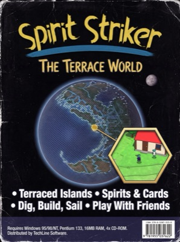
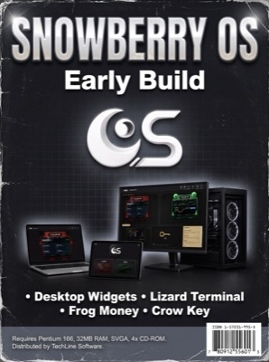
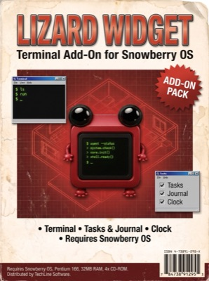
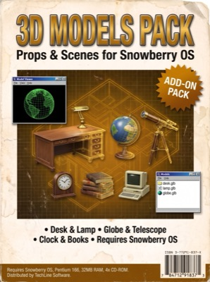
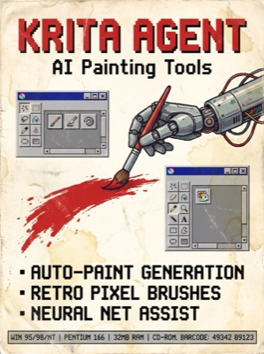

# krita-agent

[](https://github.com/Frog-dex/krita-agent/actions/workflows/ci.yml)


AI + agent tooling for [Krita](https://krita.org). It does three things:

- generates images from cloud providers straight onto the canvas
- lets external scripts and agents drive a running Krita through a file-based bridge
- builds layered `.kra` files in code using the Inherit-Alpha (clipping-mask) workflow

**Showcase page:** [`docs/index.html`](docs/index.html). To view it, open the file locally or serve `docs/` with GitHub Pages.

<br clear="right">

<p align="center"></p>

## What's inside

| Component | Path | What it does |
|---|---|---|
| **AI Image docker** | `pykrita/grok_image/` | Generates images inside Krita from several providers: Grok Imagine (xAI), Nano Banana (Gemini 2.5 Flash Image, img2img) and Imagen 4. A fourth option hands off to local krita-ai-diffusion. Each result becomes a new paint layer, sized to your selection. |
| **Krita Image Uploader** | `pykrita/krita_image_uploader/` | A file-based bridge that lets an external agent or script command Krita. It can insert images as layers, export canvas snapshots, open projects and answer a ping. Commands are JSON files in `~/.krita-image-uploader/`. |
| **`krita_bridge.py`** | `tools/krita_bridge.py` | CLI client for the bridge. It queues a command, waits for Krita's answer and exits 0 (succeeded), 1 (failed) or 2 (timed out). Stdlib only. |
| **`kra_prepare.py`** | `tools/kra_prepare.py` | Turns ordinary PNG/JPGs into a `kra_build` job: raw BGRA tiles plus `manifest.json`. It auto-lays out the images and can write an optional flat `preview.png` for sign-off. Needs Pillow. |
| **`.kra` builder** | `tools/kra_build.py` | A headless `kritarunner` script. It builds a native layered `.kra` from the job, with one group per object and an Inherit-Alpha paint layer clipped to the base shape. |
| **Docs** | `docs/` | The Inherit-Alpha how-to (clipping-mask painting, blend modes, brush gotchas), an agent-oriented Krita skill reference and the showcase page. |

## Features

- **Text-to-image and image-to-image** without leaving Krita. Nano Banana can take your whole canvas **or just the active selection** as its input image, and the result is scaled back into that exact region.
- **Colour-correct pixels.** Krita stores RGBA/U8 as BGRA in memory, and every pixel path (capture, insert, build) swaps the channels so red stays red.
- **No dependencies inside Krita.** Both plugins use only Krita's bundled Python (PyQt5 + stdlib `urllib`), so there is nothing to pip-install.
- **Non-blocking UI.** All API calls run on a `QThread` worker, so Krita stays responsive. API errors show the provider's actual message (e.g. `HTTP 400: API key not valid`).
- **Agent-friendly bridge.** Drop a JSON command file and Krita picks it up within 500 ms. It moves the file to `done/` (or writes an `.error.json`) stamped with a status and timestamp. Writes are atomic, and old snapshots are pruned (the newest 50 are kept).
- **Programmatic layered files.** `kra_prepare` + `kra_build` produce real `.kra` documents with group layers and Inherit-Alpha clipping. This is the same structure you'd build by hand for card art, marbles, or any paint-on-a-shape workflow.

## Quick Start

### 1. Install the plugins

Copy the contents of `pykrita/` into Krita's resource folder (find yours via `Settings ▸ Manage Resources ▸ Open Resource Folder`):

```bash
# macOS
cp -R pykrita/* ~/Library/Application\ Support/krita/pykrita/

# Linux
cp -R pykrita/* ~/.local/share/krita/pykrita/

# Windows (PowerShell)
Copy-Item -Recurse pykrita\* "$env:APPDATA\krita\pykrita\"
```

Then in Krita, open `Settings ▸ Configure Krita ▸ Python Plugin Manager`. Enable **AI Image (Grok / Gemini / Imagen / Local)** and **Krita Image Uploader**, then restart Krita. The dockers appear under `Settings ▸ Dockers`.

### 2. Add your API keys

**No keys ship in this repo.** The AI Image docker reads keys at generate-time (so edits apply without a restart). It checks these sources in order:

1. `~/.config/grok-image/config.json`
2. The `XAI_API_KEY` / `GOOGLE_API_KEY` environment variables

```bash
mkdir -p ~/.config/grok-image
cat > ~/.config/grok-image/config.json <<'JSON'
{
  "XAI_API_KEY": "your-xai-key-here",
  "GOOGLE_API_KEY": "your-google-key-here"
}
JSON
chmod 600 ~/.config/grok-image/config.json
```

Grok needs `XAI_API_KEY` (console.x.ai). Nano Banana and Imagen 4 need `GOOGLE_API_KEY` (aistudio.google.com), which is sent in the `x-goog-api-key` header and never in the URL. The "Local" provider needs no key; it points you to the krita-ai-diffusion docker.

### 3. Generate

Open the **AI Image** docker, pick a provider, type a prompt and press **Generate**. Each result is added as a new paint layer. For img2img, make a selection and check *"Use canvas / selection as input image"* (Nano Banana only). The output is then scaled into your selection bounds.

### 4. Drive Krita from an agent (optional)

With the Uploader plugin enabled, Krita polls `~/.krita-image-uploader/commands/` every 500 ms. The easiest way in is the CLI client:

```bash
python3 tools/krita_bridge.py ping                                  # is Krita listening?
python3 tools/krita_bridge.py insert ~/Pictures/result.png --name "AI result" --scale 0.5
python3 tools/krita_bridge.py export --max-side 1024                # -> krita/latest.png + latest.json
python3 tools/krita_bridge.py open ~/art/mycard.kra                 # open or focus a project
python3 tools/krita_bridge.py projects                              # open documents as JSON
python3 tools/krita_bridge.py live on                               # stream the canvas every 2 s
```

Or write the JSON yourself. Any file named `*.json` in `commands/` is a command (except `*.error.json` and dot-files):

```bash
cat > ~/.krita-image-uploader/commands/insert-$(date +%s).json <<'JSON'
{"action": "insert_image", "path": "~/Pictures/result.png", "name": "AI result", "scale": 1.0}
JSON
```

| Action | Fields | Result |
|---|---|---|
| `insert_image` | `path`, `name?`, `scale?` (0.05–1.0) | New paint layer in the active document (one is created if none is open) |
| `export_canvas` | `max_side?` (default 1024) | Timestamped PNG in `krita/snapshots/`, a copy at `krita/latest.png`, metadata in `krita/latest.json` |
| `open_project` | `path` | Opens the file, or focuses it if it's already open |
| `ping` | none | `message: "pong (protocol 2, Krita <version>, active: <file>)"` |

Processed commands move to `commands/done/` with `status`, `message` and `completed_at` added. Failures become `commands/<name>.error.json` with an `error` field, and unknown actions are moved to `done/` as `ignored`. The open-document list refreshes every 5 s in `krita/projects.json`. Set `KRITA_BRIDGE_ROOT` to use a different folder; the plugin and the client both honour it.

### 5. Build a layered `.kra` headlessly (optional)

```bash
# 1) Turn ordinary images into a job folder (needs Pillow). Each image becomes one group.
python3 tools/kra_prepare.py ~/kra-build card1.png card2.png card3.png \
    --bg-color "#1d1a17" --preview          # auto layout; or card.png@X,Y and --canvas 2480x3508

# 2) kritarunner only imports modules from its own pykrita dir (macOS path shown)
cp tools/kra_build.py ~/Library/Application\ Support/kritarunner/krita/pykrita/

# 3) Build
KRA_BASE=~/kra-build KRA_OUT=~/kra-build/out.kra \
  /Applications/krita.app/Contents/MacOS/kritarunner -s kra_build
cat ~/kra-build/out.kra.result.json        # kritarunner swallows print(); this is the real result
```

Example `kra_prepare` output, made from this repo's own shelf art with `python3 tools/kra_prepare.py ~/kra-build docs/shelf/*.jpg --bg-color "#2a2420" --gap 36 --margin 48 --preview`:

<p align="center"></p>

To make tiles by hand instead, note that they are 8-bit BGRA bytes (`w*h*4`). From PIL/numpy:
`np.array(im.convert("RGBA"))[:, :, [2, 1, 0, 3]].tobytes()`.

## How it works

- **AI Image docker** (`grok_image.py` + `providers.py`): a `DockWidget` with a provider combo, prompt box, count spinner and a selection-aware region readout. `providers.py` is plain stdlib (keys, request builders, response parsers, readable HTTP errors), so it is unit-tested outside Krita. A `QThread` worker runs `providers.generate()` and emits the image bytes. Each image is decoded to `QImage`, converted to RGBA8888, **swapped to BGRA**, and written into a new paint layer with `setPixelData`. When a selection was used as input, the image is first scaled to the selection rectangle. If no document is open, one is created at the image's size.
- **Uploader bridge** (`docker.py` + `bridge_core.py`): `bridge_core.py` owns the on-disk protocol: the queue, `done/`, `.error.json`, atomic writes and snapshot pruning. `docker.py` supplies the Krita action handlers. An `Extension` runs a 500 ms `QTimer` for commands (and the 5 s project list) and a 2 s timer for optional live canvas export. A docker gives you manual "Export Canvas Now" / "Process Queued Commands" buttons and a live status line.
- **`kra_prepare.py` → `kra_build.py`**: `kra_prepare` converts images to BGRA tiles plus a manifest using Pillow. `kra_build` runs inside `kritarunner` (Krita's headless Python host). It validates tile sizes, creates the document and an optional background layer, then builds each object as a group: the base shape layer, with an empty `color - Inherit Alpha` paint layer above it set to `setInheritAlpha(True)`. That is Krita's built-in clipping mask, so later painting can never spill off the shape. Full workflow docs are in [`docs/agent-skill.md`](docs/agent-skill.md) and [`docs/inherit-alpha-howto.md`](docs/inherit-alpha-howto.md).

## Development

```bash
pip install -r requirements-dev.txt   # pytest, ruff, Pillow, PyQt5
ruff check .
pytest -q                             # runs fully headless (QT_QPA_PLATFORM=offscreen)
```

The suite (41 tests) runs the **real plugin code** against `tests/fake_krita.py`, a small in-memory stand-in for Krita's `krita` module that stores pixels as BGRA the way Krita does. It covers:

- the provider request/response logic
- the bridge protocol and the CLI client, against a simulated Krita
- colour correctness of layer insertion and canvas capture
- `kra_prepare` + `kra_build` end to end

CI runs lint and tests on Python 3.10 (Krita 5.2's bundled version) and 3.12.

## Troubleshooting

- **Red and blue look swapped** on layers made by an older copy of these plugins. That was a bug, fixed in 1.1. Re-copy `pykrita/*` and restart Krita.
- **`krita_bridge.py` times out (exit 2).** Krita isn't running, or *Krita Image Uploader* isn't enabled in the Python Plugin Manager. The docker's status line shows which folder it is watching.
- **`kra_build` produced nothing.** Read `<KRA_OUT>.result.json`. Also check that the script was copied into kritarunner's own `pykrita/` folder; `-s` ignores `PYTHONPATH` and absolute paths.
- **Nano Banana says "No image returned."** The model replied with text only (often a safety refusal). Its words are shown after the message.

## Publish

Already published at [github.com/Frog-dex/krita-agent](https://github.com/Frog-dex/krita-agent). The original publish command, kept for reference:

```bash
gh repo create Frog-dex/krita-agent --public --source . --push
```

## The Sovereign Software shelf

Every box on the Spirit Strikers software shelf. Put the discs in the terminal here: https://frog-dex.github.io/terrace-world/library.html#software

| <a href="https://github.com/Frog-dex/terrace-world"></a> |  |  |  |
|:--:|:--:|:--:|:--:|
| **Terrace World**<br>the game | **Snowberry OS**<br>early build, not released yet | **Lizard Widget**<br>add-on, not released yet | **Frog Widget**<br>add-on, not released yet |

| <a href="https://github.com/Frog-dex/3d-models-pack"></a> | <a href="https://github.com/Frog-dex/plan-and-code"></a> | <a href="https://github.com/Frog-dex/krita-agent"></a> | <a href="https://github.com/Frog-dex/card-forge"></a> |
|:--:|:--:|:--:|:--:|
| **3D Models Pack**<br>thirteen free models | **Plan & Code**<br>plan a page, hand it to an AI | **Krita Agent**<br>AI tools inside Krita | **Card Forge**<br>card-making studio |

## License

[MIT](LICENSE) — Copyright (c) 2026 Blu Inman
